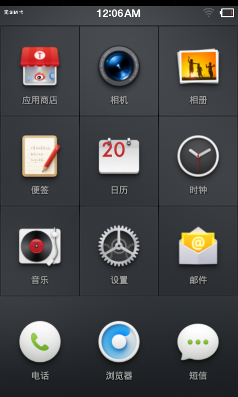
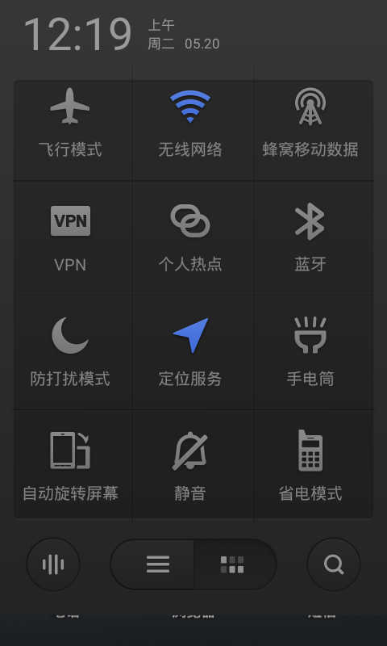

# Smartisan OS 2.0 for HTC HD2

**English** | [简体中文](README.zh-CN.md)

An unofficial SD-card port for HTC HD2 / Leo, developed on a device with 576 MB RAM and 1024 MB ROM using MAGLDR. The current **alpha1** is the final snapshot of this development session, combining NexusHD2 CM11 / Android 4.4.1 with Smartisan T1 2.0.0 / Android 4.4.2.

**[Download ROM and checksums](https://github.com/DCMMC/hd2-smartisan-os/releases/tag/v2.0-hd2-alpha1)** · [Engineering notes (Chinese)](docs/ENGINEERING.md) · [Build notes (Chinese)](docs/BUILD.md) · [XDA post draft](docs/XDA-POST.en.md) · [Sailfish companion project](https://github.com/DCMMC/hd2-sailfish-os)

The device owner confirmed correct launcher sizing and substantially smoother interaction. The quick-settings panel fits the 480×800 display with 12 controls in three columns. **This remains an experimental port with incomplete hardware testing.**

## Real-device screenshots

 

These are actual HD2 framebuffer captures, not mockups. The phone clock was unset, and battery reporting is inaccurate. See [screenshot provenance](screenshots/README.md).

## Status

| Feature | Status |
| --- | --- |
| SD boot and Android framework | Tested on the device |
| Launcher sizing and touch | Confirmed by the owner |
| Quick-settings layout | Verified in the active framebuffer |
| Responsiveness | Substantial improvement confirmed by the owner |
| USB root ADB | Automatically enabled and tested |
| Calls, mobile data, Wi-Fi, audio, camera, GPS, sensors, suspend | Not fully tested |
| Battery reporting | Known protocol/voltage-unit mismatch |
| GPU screenshot/readback | Still has genlock/readback errors |

The phone was tested through incremental updates. The final clean image has not had a separate fresh cold-boot validation cycle. Detailed limits are in [BUILD-STATUS.json](release/BUILD-STATUS.json).

## Installation

1. Download `hd2-smartisan-2.0-alpha1-SD.zip` and its `.sha256` file. Verify the checksum.
2. Extract the ZIP and copy the entire `HD2-SM20` directory to the root of the SD card's first FAT32 partition. Allow at least 2.1 GiB. `rootfs.ext4` is a 2 GiB file, below FAT32's single-file limit.
3. In MAGLDR, select **Services → BootSettings → AD SD Dir → HD2-SM20**, then **Boot AD SD**.
4. For automatic startup, set **Boot source → Android from SD** and **AlwaysMenu → NO**.

**This is an SD image ZIP, not a recovery-flashable ZIP. Do not flash it to NAND.** No repartitioning or changes to existing ext4/WP7 partitions are required. To switch systems, select another SD boot directory. Back up an existing rootfs before replacing it: the image contains that installation's settings and data. The first boot generates Dalvik caches; no fixed boot time is promised.

## Debugging

```sh
adb devices
adb shell
adb logcat -d > hd2-logcat.txt
adb pull /dev/hd2-logcat.txt
```

Root ADB starts automatically without an on-screen authorization prompt. Runtime logs rotate in RAM and disappear on reboot. Early logs are stored in `HD2-SM20` on FAT32.

## Included fixes and archive

- Legacy Adreno display queries, Vector/SortedVector and gralloc ABI compatibility.
- Runtime.gcAndTrim compatibility, emulated storage/FUSE and removal of unavailable T1 services.
- Launcher textures/layout, a separate quick-settings layout fix and HWUI texture-atlas fallback.
- Dalvik JIT, zram, animation/read-ahead adjustments and a GPS cleanup workaround.
- Always-on ADB and logging that avoids continuous SD writes.

| Path | Contents |
| --- | --- |
| `tools/`, `configs/` | Actual patch/build scripts, C/assembly shims, probes and settings |
| `logs/` | Redacted boot logs, debugging evidence, disassembly and performance records |
| `docs/` | Root causes, solutions, build inputs and workspace history |
| `release/` | Patch manifests, feature status and checksums |
| `sources.lock.json`, `reference-sources/` | Pinned upstream inputs and investigation references |

The shared archive also retains utilities and history from the companion OS; use this port's documented entry points. Earlier logs can describe superseded states. This is a binary-based adaptation, not a full Smartisan source release. See [NOTICES.md](NOTICES.md) for attribution.
