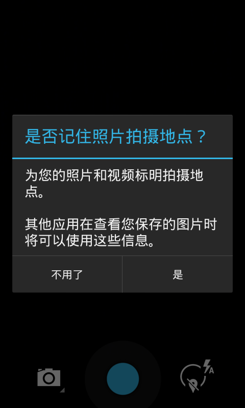

# HTC HD2 Smartisan OS 2.0

[English](README.md) | **简体中文**

这是 HTC HD2 / Leo（576 MB RAM、MAGLDR）的非官方 SD 卡移植，底层为 NexusHD2 CM11 / Android 4.4.1，系统为 Smartisan T1 2.0.0 / Android 4.4.2。**alpha2** 加入了经过实机验证的 Wi-Fi、蓝牙、相机和传感器修复，也打通了 GPS 框架/HAL 路径并降低了开机动画负载。

**[下载 alpha2 ROM ZIP 与校验文件](https://github.com/DCMMC/hd2-smartisan-os/releases/tag/v2.0-hd2-alpha2)** · [修复过程与证据](docs/ENGINEERING.md) · [构建说明](docs/BUILD.md) · [XDA 英文发帖稿](docs/XDA-POST.en.md) · [Sailfish 姊妹项目](https://github.com/DCMMC/hd2-sailfish-os)

桌面和下拉工具页已正确适配 480×800，操作流畅度明显改善。测试机上的 Wi-Fi 扫描、蓝牙、声音、振动、静态拍照和 5 个旧式传感器设备均可工作。GPS 可以初始化并启动跟踪线程，但还没有到室外验证卫星定位。

## 实机截图

  

截图均来自真实 HTC HD2。旧 Android 的 screencap 不能稳定读取相机的硬件 Surface，因此第三张展示工作相机界面；另已实测成功保存一张 2560×1920 JPEG。截图说明见 [screenshots/README.md](screenshots/README.md)。

## 功能状态

| 功能 | 状态 |
| --- | --- |
| NativeSD 启动、Android 框架、触摸 | 测试机可用 |
| 桌面、三列 12 开关下拉工具页 | 480×800 下可用 |
| Wi-Fi | 扫描和系统 AP 列表可用 |
| 蓝牙 | 能进入 ON 状态，标准 GATT profile 正常绑定 |
| 相机 | 兼容相机可预览并拍摄 2560×1920 静态照片 |
| 声音、振动 | 机主确认可用 |
| 传感器 | 加速度、磁场/方向、距离和光线设备可用 |
| GPS | HAL、定位模式和跟踪线程可用；室外卫星定位未验证 |
| USB 调试 | 从早期启动自动开启 root ADB |
| 通话、移动数据、休眠/唤醒 | 未验证 |
| 电量显示 | 旧电池协议/电压单位不匹配，数值可能不准 |

测试安装的一次正常重启约 22 秒出现 ADB、约 47 秒写入 `sys.boot_completed=1`，约 62 秒前结束开机动画。替换 framework 后的首次启动要重建 Dalvik 缓存，可能需要 2–3 分钟。

## 安装

1. 下载 `hd2-smartisan-2.0-alpha2-SD.zip` 和同名 `.sha256`，核对校验值。
2. 解压后，将整个 `HD2-SM20` 目录复制到 SD 卡第一分区 FAT32 根目录，至少留出 2.1 GiB。`rootfs.ext4` 为 2 GiB，低于 FAT32 单文件上限。
3. 进入 MAGLDR：**Services → BootSettings → AD SD Dir → HD2-SM20**，然后选择 **Boot AD SD**。
4. 自动启动：把 **Boot source** 设为 **Android from SD**，把 **AlwaysMenu** 设为 **NO**。

这是 SD 镜像压缩包，不是 Recovery 卡刷包，不要刷入 NAND；现有 ext4 和 WP7 数据分区无需调整。覆盖前请备份已有的 `HD2-SM20/rootfs.ext4`。

第一次打开“HD2 相机”时，请允许相机和位置信息权限。原锤子相机会申请 Leo PMEM 路径无法承受的 gralloc 缓冲区，所以已从 ROM 删除；包内改用独立包名 `org.hd2port.camera2` 的 NexusHD2 AOSP 相机。

## 调试

```sh
adb devices
adb shell
adb logcat -d > hd2-logcat.txt
adb pull /dev/hd2-logcat.txt
```

root ADB 无需在屏幕确认。运行日志在内存中滚动并在重启时清空；早期启动记录保存在 FAT32 的 `HD2-SM20` 目录。

## 本版修复

- 旧 Adreno 显示、Vector/SortedVector、gralloc、Binder PMEM 和 Android runtime 兼容。
- 480×800 桌面与 SystemUI 资源、HWUI 纹理回退、JIT/zram、过渡动画和 16 fps/32 帧开机动画优化。
- 单 `wlan0` 控制通道，并将旧 supplicant 的 `SCAN_RESULTS` 转换成 Android 4.4 所需格式。
- 跳过 Smartisan 专用 Qualcomm QAdapter，保留 HD2 标准 Bluedroid 路径。
- HD2 AOSP 兼容相机、旧 GPS 生命周期修复、常开 ADB 和内存日志。

仓库保留可复现补丁脚本、清单、脱敏证据和工程说明。专有系统二进制只放在 Release ROM 压缩包内。这是二进制移植，并非完整 Smartisan 源码发布；版权与来源见 [NOTICES.md](NOTICES.md)。
